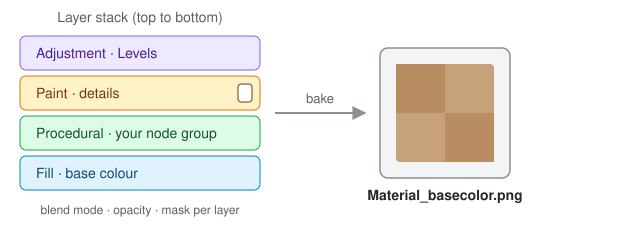
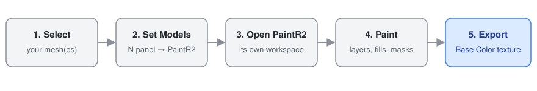

# PaintR2

**Layered texture painting inside Blender** — and the result exported as real
texture files.

Blender's Texture Paint works on one image at a time; there are no layers. You
can build layer logic in the shader, but a shader mix is not a file you can
export. PaintR2 joins the two: paint in a stack of layers, take the result out
as PNG or EXR.

<p align="center"></p>

---

> ### ⚠️ Under development
>
> PaintR2 is **still being built** and has not reached 1.0 (the current series
> is `0.11.x`). What it does today is **simple-level** texture painting: a layer
> stack, painting, fills, masks, and a **Base Color** export. It is not a
> substitute for a full material pipeline.
>
> In practice that means:
>
> - **Don't rely on it alone for serious work.** Try it on a copy first, and
>   save often.
> - **The interface and behaviour can change** between versions.
> - **You will probably hit bugs.** If you do, please
>   [open an issue](https://github.com/r2detta/PaintR2/issues) — saying what you
>   were doing and what Blender's console printed helps enormously.
>
> What is deliberately left out is below: [Known limits](#known-limits).

---

## Requirements

- **Blender 5.2 LTS.** Only. It will not run on earlier versions.

## Installation

**From a release (recommended):** download `PaintR2-<version>.zip` from the
[Releases](https://github.com/r2detta/PaintR2/releases) page, then in Blender
pick `Edit → Preferences → Add-ons → ▾ → Install from Disk`.

The green **Code → Download ZIP** button gives you a file that installs the same
way — Blender takes the extension's identity from the manifest, not from the
folder name. The only difference is that this zip also carries the baker's C++
source, so the install takes a few hundred kilobytes more. The release package
has that stripped out.

**From source:** clone the repository and link it into your extensions folder:

```bash
git clone https://github.com/r2detta/PaintR2.git
ln -s "$PWD/PaintR2" ~/.config/blender/5.2/extensions/user_default/PaintR2
```

---

## Quick start

<p align="center"></p>

1. In the 3D viewport, select the mesh (or meshes) you want to paint.
2. Press `N` to open the sidebar and switch to the **PaintR2** tab.
3. Choose a resolution, then press **Set Models**.
   An object with no material gets one called `<object>_Paint`; an object that
   already has one **keeps the name but has the material reset in place** — so
   whatever was in that material is gone, and only its name survives.
4. Press **Open PaintR2**. The window switches to a PaintR2 workspace with the
   layers and painting tools in it.
5. When you are done, press **Export** in the top right to bake and write the
   textures, then **Close** to go back to the workspace and mode you came from.

The sidebar is only for setting up. Everything else — painting, mesh map
baking, saving layer images and export — happens in the PaintR2 workspace.

---

## What's in it

**Layers**
- Add, delete, reorder, hide; drag and drop to move
- Blend mode and opacity **per channel**, picked from the channel menu in the
  Layers header
- Right-click a layer, its colour or its mask for the commands that belong to
  what you clicked
- **Groups** — nested, with the group's mask and opacity applied to the whole
  subtree
- Layer masks, and viewing a mask on its own
- Colour labels, multiple selection, copy and paste
- Paint, fill, procedural, adjustment and node layer types

**Painting**
- In the 3D viewport, through Blender's own brush engine (pressure and stroke
  smoothing included)
- Every brush, stroke, falloff, cursor and texture setting, inside PaintR2
- Symmetry: X / Y / Z and a mirror plane

**Fill tools**
- **Polygon Fill** — triangle or polygon
- **Mesh Fill** — connected part or whole object
- **UV Island Fill** — one UV island
- Box and lasso selection, drag to fill, edge softening and bleed
- Its own undo ring (`Ctrl Z`)

**Channels**
- **Base Color, Roughness, Metallic, Normal and Height** on every material
- A layer writes to the channels you switch on in its Properties; new layers
  start with Base Color only
- Fill layers can take an **image in any channel** — a colour map, a roughness
  map, a normal map — placed by UV or Planar projection with position,
  rotation and (uniform) scale; DirectX normal maps are converted on the fly
- Height adds up between layers; normal detail is combined onto the baked
  high-poly normal rather than replacing it

**Procedural and adjustment**
- Your own node group as a layer or as a mask — and it can read the baked
  mesh maps (AO, curvature, …) as inputs; its one output drives whichever
  channels the layer writes to
- Adjustment layers: HSV, Levels, Bright/Contrast, Gamma, Clamp, Posterize,
  Invert
- A per-layer effect stack

**Preview and export**
- **Bake and export the final textures** per material: Base Color,
  Roughness, Metallic, Normal (with the height baked in, OpenGL or DirectX)
  and Height — pick which ones, as PNG, OpenEXR, Targa or JPEG
- Preview modes: PBR, Unlit, Diffuse, and a baked mesh map on its own
- Lighting, HDRI and view transform controls inside the workspace

**Mesh map baking** (in the workspace's **Bake** page)
- Ambient Occlusion, Curvature, Thickness, Position
- Normal, Height and Bent Normal from a high-poly, with a one-click cage
  measurement
- Bake every model or only the active one; choose whether the other models
  shadow a model's Ambient Occlusion or it is baked as if alone
- Look at any baked map on the model with one click

**Multiple objects and materials** — painted as one set, and exported together.

---

## Shortcuts

Press `F1` or `?` inside PaintR2 for the full list. The common ones:

| Key | What it does |
|---|---|
| `↑` `↓` | Select the layer above / below |
| `Ctrl ↑` `Ctrl ↓` | Move the layer |
| `M` | Turn the mask off / back on |
| `Shift M` | Show the mask on its own |
| `I` | Show the layer on its own |
| `X` | Delete the layer, its mask, or the selected filter |
| `Ctrl G` | Group the selected layers |
| `Ctrl C` / `Ctrl V` | Copy / paste layers |
| `Ctrl Z` | Undo a fill |

On macOS, `Cmd` works wherever `Ctrl` is listed.

---

## About the mesh map baker

Mesh maps can go through an accelerated baker shipped with the add-on, in
`bin/<platform>/`. The release zip carries it for **Windows x64**, **macOS on
Apple Silicon** and **Linux x86-64**; the add-on picks the one for your machine.
It uses your GPU through OpenCL, and your processor when there is no OpenCL
driver.

If there is no baker for your platform, or it cannot be started (an antivirus
holding it back, for example), the add-on falls back to **Cycles** for you: the
maps are still produced, just more slowly, and the report says that it
happened. The one exception is **Bent Normal**, which only the accelerated
baker can produce — on the Cycles path it is skipped, and the report says so.

The baker's source is under `PaintR2Bake/`. On Linux, `build.sh` builds it;
every platform builds with CMake:

```bash
cmake -S PaintR2Bake -B build -DCMAKE_BUILD_TYPE=Release
cmake --build build --config Release
```

The release binaries are built by `.github/workflows/build.yml`.

---

## Known limits

**Deliberate limits** — these are not missing features, they are decisions:

- **Resolution cannot be changed afterwards.** It is chosen in Set Models and
  stays. Rescaling would mean resampling every layer and every mask, which is an
  unrecoverable loss. If you started wrong, the way out is a new material.
- **One PaintR2 session at a time.**
- **No UDIM.** A single UV tile.
- **The brush paints Base Color only.** Roughness, Metallic, Normal and Height
  are given by Fill layers (a value or an image) and shaped with masks.
- No smart materials or smart masks.


---

## Licence

GPL-3.0-or-later. Full text in [LICENSE](LICENSE).

`PaintR2Bake/third_party/tiny_bvh.h` is MIT licensed; its copyright and
permission notice are in the file's own header.
